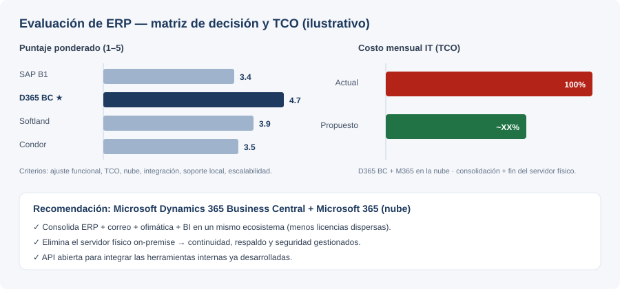

# 📊 Caso de estudio: Modernización de ERP e Infraestructura IT

> Business case de transformación digital para una **agencia marítima**: diagnóstico del estado
> actual, evaluación de 4 proveedores de ERP, modelo de costo total (TCO) y propuesta de migración
> a la nube. Muestra el lado **analista funcional / transformación digital** del perfil:
> relevamiento, análisis financiero y recomendación basada en datos.


> ℹ️ **Versión sanitizada para portafolio.** Está basado en un proyecto real, pero la empresa
> (*Atlantic Maritime Agency / AMA*), los proveedores específicos y **todas las cifras son
> ilustrativas/ficticias**. El documento original es confidencial y **no** forma parte de este repo.



---

## 1. Contexto y problema

AMA, agencia marítima, operaba sobre una **infraestructura IT fragmentada**: un ERP legado limitado,
un **servidor físico on-premise**, herramientas dispersas y varios procesos administrativo-financieros
manuales. Esto generaba **costos recurrentes altos**, riesgo operativo (un solo servidor físico) y
fricción en el cierre contable y las rendiciones.

**Objetivo del análisis:** evaluar opciones de ERP modernas, cuantificar el costo total de propiedad
(TCO) y recomendar un camino que **reduzca costos**, **migre a la nube** y **consolide** el stack.

## 2. Estado actual (diagnóstico)

- **Technology landscape:** ERP legado + planillas + utilidades a medida + correo y ofimática sueltos.
- **Costo mensual (ilustrativo):** licencias dispersas + mantenimiento del servidor físico + soporte.
- **Pain points:** sin nube (continuidad/respaldo), integraciones manuales, doble carga, reporting lento.

## 3. Evaluación de proveedores

Se evaluaron 4 ERPs contra criterios ponderados (ajuste funcional, TCO, nube, integración, soporte
local, escalabilidad). Puntajes **ilustrativos** 1–5:

| Criterio (peso) | SAP Business One | **Microsoft D365 BC** | Softland | Condor |
|---|:--:|:--:|:--:|:--:|
| Ajuste funcional (25%) | 4 | **5** | 4 | 3 |
| TCO / costo (25%) | 2 | **4** | 4 | 5 |
| Nube nativa (20%) | 4 | **5** | 4 | 2 |
| Integración / API (15%) | 4 | **5** | 3 | 3 |
| Soporte local (10%) | 4 | **4** | 5 | 4 |
| Escalabilidad (5%) | 5 | **5** | 3 | 3 |
| **Puntaje ponderado** | 3.4 | **4.7** | 3.9 | 3.5 |

## 4. Recomendación

**Microsoft Dynamics 365 Business Central + Microsoft 365**, en la **nube**:

- **Consolidación**: ERP + correo + ofimática + BI (Power BI) sobre un mismo ecosistema, reduciendo
  licencias dispersas y costos de integración.
- **Nube**: elimina el servidor físico on-premise (continuidad, respaldo y seguridad gestionados).
- **Integración**: API abierta para conectar las herramientas internas ya desarrolladas
  (facturación, conciliación, manifiestos).

## 5. Impacto (modelo financiero, cifras ilustrativas)

```
Costo mensual actual (stack fragmentado + servidor físico)  ████████████  100%
Costo mensual propuesto (D365 BC + M365 en la nube)         ████████      ~XX% menos
```

> El modelo de TCO comparó el costo recurrente actual contra el del stack consolidado en la nube,
> mostrando un **ahorro mensual significativo** y la eliminación del riesgo del servidor único.
> *(El porcentaje real está en mi CV / disponible en entrevista; acá se omite por confidencialidad.)*

## 6. Mi rol

- **Relevamiento** del estado actual (landscape, costos, pain points) y de requerimientos.
- **Evaluación** de proveedores y armado de la **matriz de decisión** ponderada.
- **Modelo financiero / TCO** comparando escenarios y cuantificando el ahorro.
- **Propuesta de migración a la nube** y consolidación en Microsoft.
- **Business case e investment proposal** presentados a la dirección.

## Skills que demuestra

Análisis funcional · relevamiento de procesos · evaluación de proveedores (RFP/scoring) ·
modelado financiero / TCO–ROI · estrategia cloud · comunicación con dirección (business case).

## ♻️ ¿A quién le sirve / cómo reutilizarlo?

Sirve como **plantilla de business case** para evaluar y justificar un cambio de ERP/infraestructura ante la
dirección. Reutilizá la estructura: diagnóstico → criterios ponderados → matriz de decisión → modelo TCO →
recomendación. Cambiá proveedores, pesos y números por los de tu caso. Útil para **analistas funcionales,
IT y áreas de administración** que tengan que fundamentar una inversión con datos.
